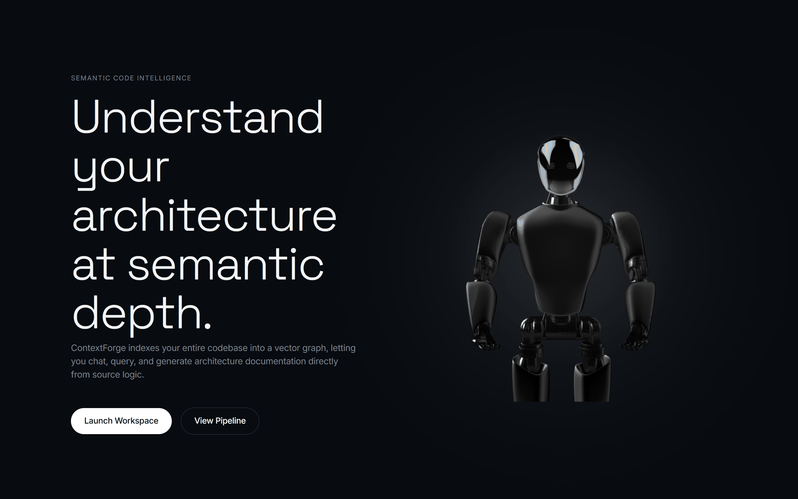
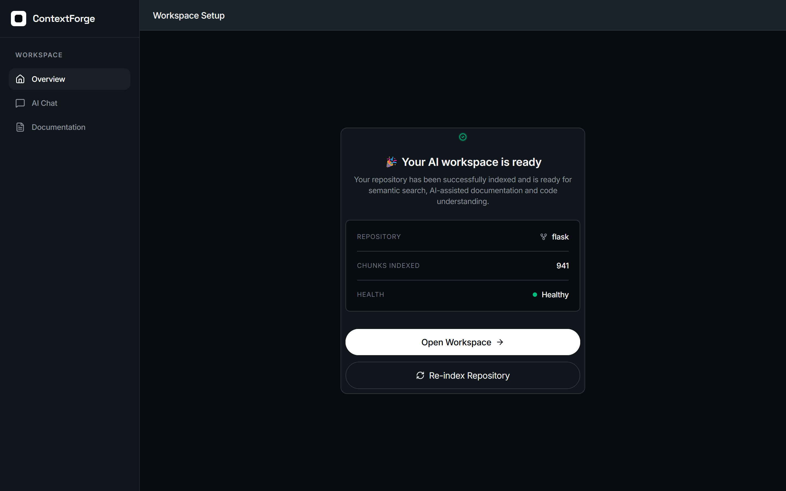
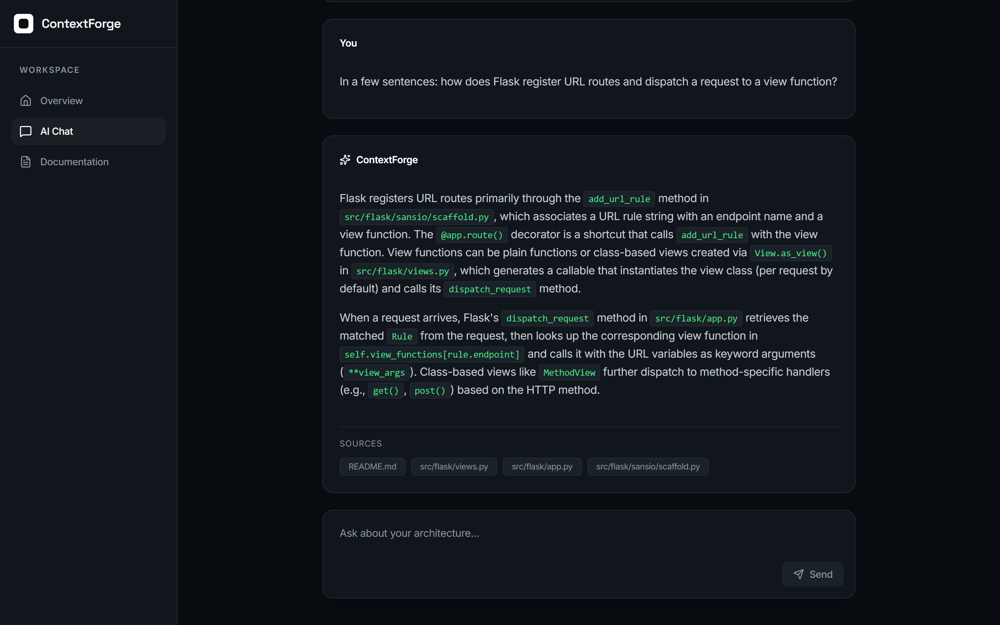
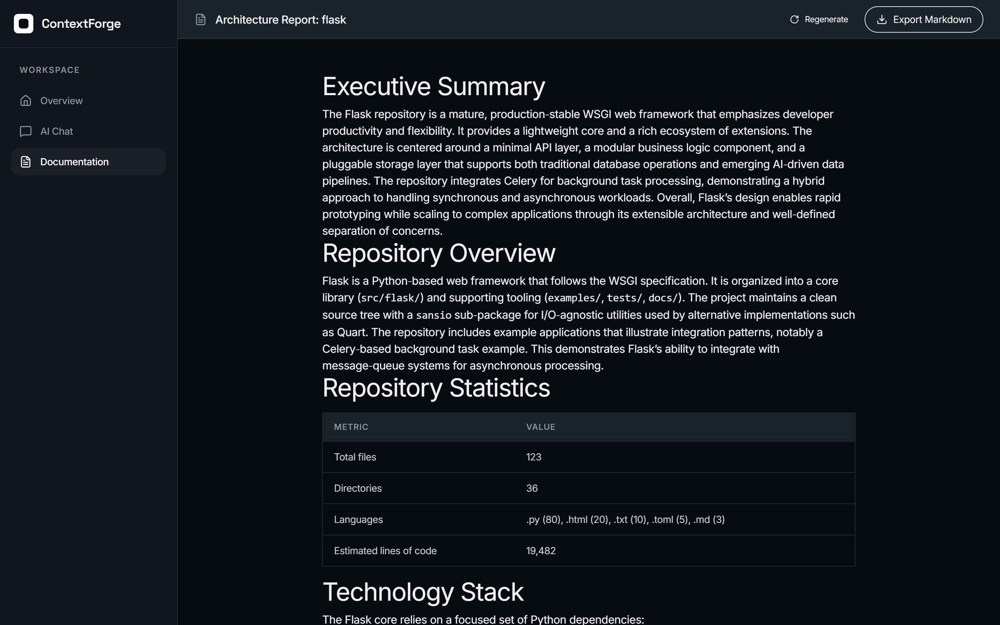
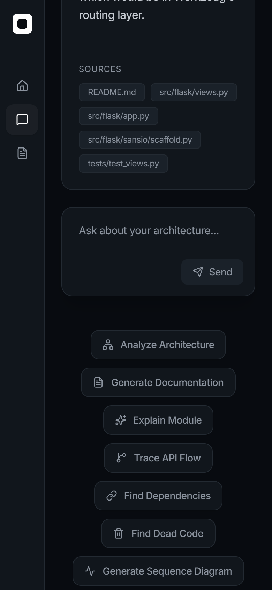
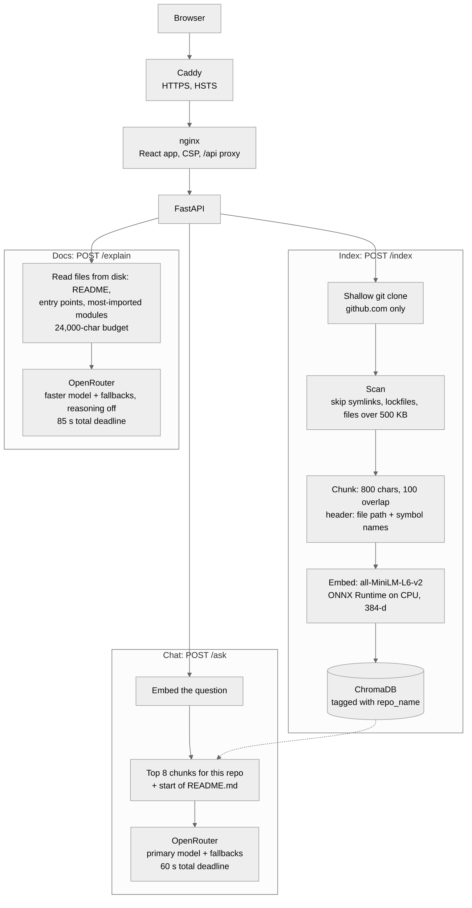

# ContextForge

Ask questions about any GitHub repository and get answers that cite the actual code.

[](https://contextforge-dig.indiasouthcentral.cloudapp.azure.com)
[](https://github.com/Digvijay-999/Codebase-Memory-Engine/actions/workflows/ci.yml)
[](LICENSE)
[](backend/requirements.txt)
[](frontend/package.json)

**[Live demo](https://contextforge-dig.indiasouthcentral.cloudapp.azure.com)** · **[Video walkthrough](https://youtu.be/h9O256LnUMY)** · **[Deployment guide](DEPLOY.md)**

<!-- LAUNCH_VIDEO -->


## What it does

- Paste a public GitHub URL. ContextForge clones it, splits the code into chunks and stores their embeddings.
- Ask a question in the chat. The answer is built from the 8 most relevant chunks and lists the files it used.
- Generate an architecture report or a README for the repository, and export it as Markdown.
- Each repository's index is kept separate, so answers only draw on the repository you picked.

## Screenshots

| Landing | Overview |
|---|---|
|  |  |
| **Chat** | **Docs** |
|  |  |

<p align="center"></p>

## How it works



1. **Clone.** Only `https://github.com/<owner>/<repo>` URLs are accepted. The clone is shallow and size-checked before it is kept.
2. **Scan and chunk.** Source files are cut into 800-character windows. Each chunk starts with its file path and the names of the functions and classes in it.
3. **Embed.** A MiniLM model runs on ONNX Runtime on the CPU (no PyTorch). Vectors go into one ChromaDB collection, tagged with the repo name.
4. **Ask.** The question is embedded, the 8 nearest chunks from that repo are retrieved, and the model is told to cite files and to give a partial answer rather than refuse.
5. **Report.** The Docs page skips retrieval. It reads the README, the entry points and the modules other files import most, and sends them to a faster model. The prompt tells it to describe only that code and to say so when something isn't visible.

## Tech stack

| Area | Tools |
|---|---|
| Frontend | React 19, Vite 8, Tailwind CSS 4, React Router 7, Framer Motion, react-markdown |
| Backend | Python 3.11, FastAPI, Uvicorn, Pydantic, GitPython |
| Retrieval | all-MiniLM-L6-v2 on ONNX Runtime (CPU), HuggingFace tokenizers, ChromaDB |
| LLM | OpenRouter (OpenAI SDK), free models with fallback lists, anyio deadlines |
| Infra | Docker Compose, nginx, Caddy (automatic HTTPS), Azure VM |
| Testing | pytest, ESLint, GitHub Actions |

## Engineering highlights

**Docs report: 129 s to 10–32 s.** The report timed out in the UI at 129 s. Diagnosis: token throughput of the model. Fix: whole-repo prompts go to a faster model with reasoning turned off. *Measured:* `/explain` wall time on the live server before and after the change (commit `37a2af6`). The run for the screenshot above took 12 s.

**Retrieval hit rate on flask.** Top-5: 7/10 → 9/10. Top-10: 8/10 → 10/10. Each chunk now starts with its file path and the symbols it defines, and each answer uses 8 chunks instead of 5. *Measured:* 10 questions about flask ([docs/eval/flask_questions.json](docs/eval/flask_questions.json)), each with the functions that answer it. A hit means one of the top k chunks overlaps the body of one of those functions, located with Python's `ast` (commit `c188f19`). On 2026-11-13 the live index scored top-5 9/10, top-8 9/10, top-10 10/10. To reproduce, point the script at a backend and a checkout of the indexed commit:

```bash
cd backend
python scripts/eval_retrieval.py --base-url http://127.0.0.1:8001 --source repos/flask
```

**Indexing on a 1 GB VM: about 7x faster.** express (1,084 chunks) took 626 s with an embedding batch of 64. The CPU sat about 70% in I/O wait because it was swapping. With a batch of 8 it took 87 s (1.7 → 12.5 chunks/s). *Measured:* wall time of `/index` on the live VM, with memory, swap and I/O wait watched during the run ([DEPLOY.md](DEPLOY.md)). Re-indexing flask for the screenshot above took 78 s for 941 chunks.

**A real total deadline on LLM calls.** The SDK timeout only covered single reads, so a slow response plus a retry and the fallback models could run past the browser's timeout. Every call, including the retry and the fallback models, now runs inside one `anyio.fail_after` deadline: 60 s for chat, 85 s for reports. On expiry the upstream request is cancelled and the API returns 504, before the browser's own timeout (90 s / 110 s).


## Security

- **Clone allowlist:** only `https://github.com/<owner>/<repo>`, checked before git runs. Shallow clone, no submodules, time, size and file-count limits.
- **Filesystem:** symlinks in cloned repos are never followed, and repo names are reduced with `os.path.basename` to block path traversal.
- **Abuse limits:** per-IP rate limits for chat, indexing and search, plus a daily cap on LLM calls for the whole demo.
- **Headers:** Content-Security-Policy from nginx, HTTPS and HSTS from Caddy.
- **Containers:** the backend runs as a non-root user (uid 10001). Only Caddy publishes ports in production.
- **Production mode:** debug routes and the OpenAPI docs are off.

There is no login. Treat any deployment as public.

## Run locally

You need Docker with the Compose plugin and an [OpenRouter](https://openrouter.ai) API key (free models work).

```bash
git clone https://github.com/Digvijay-999/Codebase-Memory-Engine.git
cd Codebase-Memory-Engine
cp backend/.env.example backend/.env   # set OPENROUTER_API_KEY
cp .env.example .env                   # optional: model choices, limits
docker compose up -d --build
```

- App: http://localhost:3000
- API (debugging only): http://127.0.0.1:8001/health

Without a key, indexing and search still work; the chat and reports return 401.

**Frontend dev mode.** Keep the backend container running, then:

```bash
cd frontend
npm install
npm run dev   # http://localhost:5173, proxies /api to the backend on :8001
```

## Deployment

The live demo runs on a 1 GB Azure for Students VM with 4 GB of swap. Caddy gets the HTTPS certificate automatically. Images are built on another machine and shipped to the VM, since building there can run out of memory.
Full steps, backups and restores: [DEPLOY.md](DEPLOY.md).

## Project structure

```
backend/
  config/       settings from environment variables
  routers/      every API endpoint
  services/     clone, scan, chunk, embed, LLM, rate limits
  schemas/      request bodies
  tests/        pytest suite (no network, fake embeddings)
  scripts/      model download, manual checks
frontend/
  src/          React app: pages, components, api client
  public/       self-hosted fonts and the 3D scene
docs/
  assets/       screenshots and social preview
  archive/      early design notes (outdated)
scripts/        deploy, backup, restore
docker-compose.yml, compose.prod.yml, Caddyfile
```

## Testing

- `cd backend && python -m pytest -q`: 70 tests covering the API, the URL allowlist, clone limits, symlinks, rate limits and the LLM endpoints with OpenRouter stubbed. On Windows 67 pass and 3 symlink tests are skipped.
- `cd frontend && npm run lint && npm run build`
- [CI](.github/workflows/ci.yml) runs both on every push and also builds both Docker images.

## Limitations and roadmap

- Answer time depends on the free models on OpenRouter and changes from day to day.
- The demo server only indexes repositories up to 300 files and 1 MB, to fit in 1 GB of RAM. Self-hosted, the defaults are 5,000 files and 100 MB.
- There is no login. It's a public demo, protected only by rate limits and a daily cap.
- Answers arrive all at once. There is no streaming yet.

Next:

1. Stream answers token by token.
2. Use code-aware chunking (split on functions and classes) instead of fixed windows.
3. Pull new commits when a repository is re-indexed.

## License and author

MIT, see [LICENSE](LICENSE).

Built by **Digvijay Yogesh Patil**. [GitHub](https://github.com/Digvijay-999) · [LinkedIn](https://www.linkedin.com/in/digvijay-patil-732035379)
